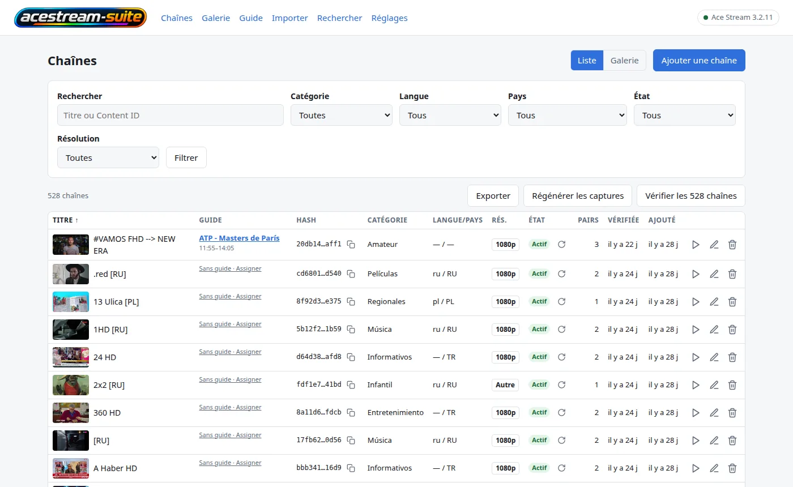

# acestream-suite

🇬🇧 [English](README.md) · 🇪🇸 [Español](README.es.md) · 🇫🇷 **Français** · 🇮🇹 [Italiano](README.it.md) · 🇩🇪 [Deutsch](README.de.md) · 🇷🇺 [Русский](README.ru.md) · 🇨🇳 [中文](README.zh.md) · 🇯🇵 [日本語](README.ja.md)

<p align="center"></p>

**Origine.** L'idée et la base de cette application viennent du projet **AceList**
(<https://github.com/fabiomb/AceList>) : un catalogue local de liens AceStream. Cette suite est cette
idée étendue avec des composants qui lui sont propres, et `LICENSE` consigne ce que cela implique si
vous la redistribuez.

Une interface web auto-hébergée pour un moteur **AceStream**. Elle tient un catalogue de liens
`acestream://` — des chaînes avec leur Content ID, une vérification de disponibilité auprès du moteur,
une image capturée de chacune, des catégories, des langues et des pays — et ajoute quatre choses
autour de ce catalogue :

- **une couche de guide (EPG)** : des sources XMLTV, un mapping chaîne↔guide, une fenêtre de
  programmes stockée, un document XMLTV à `/epg.xml` et une playlist M3U qui porte le guide ;
- **une page de recherche** sur l'index du moteur lui-même (`acesearch`), pour trouver et importer
  les chaînes que l'index connaît et que le catalogue ignore ;
- **un pont HLS** qui transforme un flux du moteur en un manifeste que plusieurs lecteurs de la
  maison peuvent regarder en même temps ;
- **des scripts** qui publient le catalogue sous forme de playlists pour les lecteurs qui veulent une
  URL plutôt qu'une page web (VLC, Kodi, Dispatcharr/Jellyfin Live TV, une TV connectée).

`acestream-suite` est ce produit. **AceStream** est le moteur avec lequel il lit : le moteur est un
logiciel tiers et conserve son propre nom.

> **Pas d'authentification.** L'application est prévue pour un réseau privé. Quiconque atteint le port
> peut parcourir le catalogue et démarrer des flux. Ne la publiez pas sur internet.

## Captures d'écran

<p align="center"></p>

L'interface existe en huit langues. Le sélecteur en haut de page change le README ; la langue de
l'application se choisit dans **Réglages** ou avec `ACESTREAM_SUITE_LANGUAGE` (`es`, `en`, `fr`, `it`,
`de`, `ru`, `zh`, `ja`). Une capture par langue se trouve dans `assets/screenshots/`.

## Démarrage rapide (Docker)

Prérequis : Docker avec Compose v2, et un moteur AceStream joignable en HTTP depuis le conteneur
(cette suite n'en démarre aucun).

```bash
git clone https://github.com/yerbajo/acestream-suite.git
cd acestream-suite
cp .env.example .env
$EDITOR .env                      # ACESTREAM_SUITE_ENGINE_URL, ACESTREAM_SUITE_ALLOWED_HOSTS
mkdir -p data && sudo chown 1000:1000 data
docker compose up -d --build
curl -fsS http://localhost:8080/health
```

Ouvrez ensuite **`http://<host>:8080`** — `ACESTREAM_SUITE_PORT` dans `.env` est le port de l'hôte
(`8080` sauf si vous le changez ; l'application écoute toujours sur 8000 à l'intérieur du conteneur).
Le pont HLS publie le **8084**.

Deux détails qui vont poser problème si on les saute :

- **`data/` doit exister et être accessible en écriture par l'uid 1000.** Docker crée une source de
  bind manquante comme un répertoire vide appartenant à root, et l'application tourne en `"1000:1000"`,
  donc elle ne pourrait pas écrire sa base de données.
- **Les valeurs du déploiement viennent de `.env`, pas du fichier compose.** `docker-compose.yml`
  interpole chaque valeur qui diffère d'un déploiement à l'autre (`${ACESTREAM_SUITE_ENGINE_URL:-…}`
  et compagnie), donc `cp .env.example .env` plus une édition suffit et le fichier compose lui-même
  n'a jamais besoin d'être touché. Tout ce que vous laissez hors de `.env` retombe sur la valeur par
  défaut sûre écrite dans le compose. L'URL du moteur, ses timeouts, l'URL de recherche et la
  concurrence des vérifications sont en plus des *réglages enregistrés* dans la page **Ajustes** de
  l'application, et une valeur enregistrée l'emporte sur l'environnement — donc un `.env` faux se
  corrige depuis l'interface, sans reconstruction.

## L'image est construite localement, depuis ce dépôt

`docker compose up -d --build` **construit** l'image ; rien n'est tiré à part la base
`python:3.12-slim` et les paquets de la distribution. Le code de l'application est ici : `app/`
(l'application FastAPI), `migrations/` (Alembic) et `pyproject.toml`, copiés dans l'image et installés
en mode éditable, parce que l'application lit ses templates, ses fichiers statiques et ses migrations
relativement à l'arborescence source.

`ffmpeg` est installé dans l'image parce que les captures d'écran et la vérification de disponibilité
lisent le flux en direct à travers lui.

Mise à jour :

```bash
git pull
docker compose build acestream-suite && docker compose up -d acestream-suite
```

Nommer le service compte : le même fichier compose contient aussi le pont `acestream-suite-hls`, et un
`docker compose up -d` nu le recréerait lui aussi.

## Configuration

Chaque variable est lue par l'application depuis son environnement. Les noms principaux sont
`ACESTREAM_SUITE_*` ; les anciens noms `ACELIST_*` sont encore lus en repli pendant une version, donc
un déploiement qui n'a pas encore été renommé continue de fonctionner (le nouveau nom l'emporte quand
les deux sont définis).

| Variable | Par défaut | Ce qu'elle fait |
|---|---|---|
| `ACESTREAM_SUITE_ENGINE_URL` | `http://127.0.0.1:6878` | URL de base de l'API HTTP du moteur. Aussi un réglage enregistré. |
| `ACESTREAM_SUITE_ENGINE_TIMEOUT` | `15` | Secondes d'attente du moteur avant qu'un appel soit considéré comme en échec. |
| `ACESTREAM_SUITE_SEARCH_URL` | vide = l'URL du moteur | URL de base d'`acesearch`, l'index que lit la page de recherche (`/search.m3u`). Aussi un réglage enregistré. |
| `ACESTREAM_SUITE_ALLOWED_HOSTS` | vide | Valeurs `host` / `host:port` séparées par des virgules, acceptées dans l'en-tête `Host` et dans l'`Origin` d'une écriture. Sans l'adresse depuis laquelle vous naviguez, chaque requête est un `400` et chaque écriture un `403`. |
| `ACESTREAM_SUITE_PLAYBACK_MODE` | `vlc` | `vlc` démarre le flux et ouvre un lecteur local (le comportement de bureau). `url` démarre le flux et passe le lien à la page — le mode dont un conteneur a besoin, puisqu'il n'a pas de lecteur. |
| `ACESTREAM_SUITE_STREAM_PARAM` | `id` | Paramètre de requête qui démarre un flux sur le moteur : `id` pour le build Windows 3.1.x, `infohash` pour le build Linux 3.2.x (qui répond `failed to load content` à `id`). |
| `ACESTREAM_SUITE_CHECK_CONCURRENCY` | `2` | Vérifications de disponibilité simultanées. Chacune est une session réelle sur le moteur, donc c'est aussi la charge imposée au moteur. |
| `ACESTREAM_SUITE_SCREENSHOT_TIMEOUT` | `30` | Secondes accordées à la capture d'image par ffmpeg. |
| `ACESTREAM_SUITE_FFMPEG_PATH` | vide = `ffmpeg` dans le `PATH` | Le binaire utilisé pour les captures. |
| `ACESTREAM_SUITE_VLC_PATH` | vide = les dossiers habituels, puis le `PATH` | Lu uniquement en mode de lecture `vlc`. |
| `ACESTREAM_SUITE_DATA_DIR` | `/data` dans l'image, le répertoire de données du système ailleurs | Où vivent `acestream-suite.db` et `screenshots/`. |
| `ACESTREAM_SUITE_PORT` | `8080` | Port publié sur l'hôte. L'application écoute toujours sur `8000` à l'intérieur du conteneur. |
| `ACESTREAM_SUITE_EPG_SOURCES` | `[]` | Sources XMLTV, sous forme de liste JSON d'URL. Le vide est un état pris en charge : le catalogue fonctionne sans guide. |
| `ACESTREAM_SUITE_EPG_WINDOW_HOURS` | `72` | Jusqu'où en avant de *maintenant* le guide est conservé ; les programmes plus anciens sont élagués à chaque rafraîchissement. |
| `ACESTREAM_SUITE_EPG_TIMEOUT_SECONDS` | `120` | Délai d'attente par source du rafraîchissement. Une source qui ne répond jamais coûte une source, pas la passe. |
| `ACESTREAM_SUITE_EPG_MAX_MB` | `64` | Une source plus grosse que cela est refusée au lieu de remplir la mémoire du conteneur. |
| `ACESTREAM_SUITE_EPG_GRACE_SECONDS` | `300` | Secondes supplémentaires pendant lesquelles un programme qui vient de finir est conservé, pour les lecteurs dont l'horloge retarde. |
| `ACESTREAM_SUITE_EPG_ACTOR` | vide = l'utilisateur du système | Nom enregistré comme auteur d'une décision manuelle chaîne↔guide. |

**Lesquelles de ces variables `.env` peut définir, c'est le fichier compose qui en décide.** Il
interpole `ENGINE_URL`, `ALLOWED_HOSTS`, `PLAYBACK_MODE`, `STREAM_PARAM`, `CHECK_CONCURRENCY`, `PORT`,
`EPG_SOURCES`, `EPG_WINDOW_HOURS` et le `HLS_ALIASES` du pont — exactement les noms que livre
`.env.example`. Les autres sont lues par l'application mais pas transmises par le compose : ce sont
soit des réglages enregistrés dans **Ajustes** (délai du moteur, URL de recherche, délai de
vérification, pairs minimum, délai de capture, chemin de ffmpeg, chemin de VLC), soit des valeurs que
vous ajoutez vous-même à `environment:` dans le compose (répertoire de données, les délais et le
plafond de taille du guide, le nom de l'acteur).

Deux remarques :

- La fréquence de rafraîchissement du guide n'est pas de la configuration : c'est l'horaire de
  `scripts/acestream-suite-guide-refresh.cron` (04:07 et 16:07), et rien dans le conteneur ne lit un
  intervalle. Changez cette ligne pour changer la fréquence.
- Le fichier de base de données est `acestream-suite.db`, dans le répertoire de données vers lequel
  l'application pointe.

## Données et sauvegardes

Tout l'état de l'application tient dans un seul répertoire, monté sur `/data` et lié à `./data` dans
le fichier compose :

```
data/
  acestream-suite.db   SQLite : catalogue, historique des vérifications, tables du guide, réglages
  screenshots/    une image capturée par chaîne
```

Pour la sauvegarder, copiez le répertoire pendant que l'application n'y écrit pas :

```bash
docker compose stop acestream-suite
tar czf "acestream-suite-data-$(date +%F).tar.gz" data
docker compose start acestream-suite
```

Une copie prise d'un conteneur en marche peut attraper le fichier SQLite au milieu d'une écriture. Le
script `acestream-suite-prune` (plus bas) prend exactement ce type de copie avant de supprimer quoi
que ce soit, avec un export réimportable du catalogue complet.

Pour restaurer : arrêtez l'application, remplacez `data/`, redémarrez-la. L'entrypoint applique les
migrations de la base au démarrage, donc une sauvegarde d'une version plus ancienne est mise à niveau
plutôt que rejetée.

## Comment le code source est organisé

| Chemin | Ce que c'est |
|---|---|
| `app/` | L'application web : routes FastAPI, templates, fichiers statiques, le client du moteur, le guide et la recherche. |
| `migrations/` + `alembic.ini` | Le schéma de la base de données, appliqué au démarrage du conteneur par `entrypoint.sh`. |
| `tests/` | La suite de tests de l'application (pytest, ~640 tests, sans réseau) : `pytest -q` depuis la racine du dépôt. |
| `scripts/` | Les tâches optionnelles de l'hôte : les constructeurs de playlists, l'importateur de jour de match, l'élagage, leurs fichiers `.cron` et `crons-install.sh`. |
| `assets/` | Le logo et le favicon que l'image copie dans le répertoire statique de l'application. |

La provenance, et ce que cela signifie pour vous, est dans `LICENSE`.

## Le pont HLS

Les moteurs de la série 3.2.x ne servent pas de manifeste HLS, et plusieurs clients (TV connectées,
Dispatcharr, Jellyfin Live TV) en veulent un. `acestream-suite-hls` — le second service du même
fichier compose, issu de la même image — remuxe le MPEG-TS du moteur, sans réencodage, en segments de
2 secondes et sert :

```
http://<host>:8084/<infohash>/index.m3u8
```

Un `ffmpeg` par chaîne, quatre sessions au maximum, une session fermée 45 secondes après la dernière
requête, la fenêtre de segments dans un tmpfs de 2 Go, et la session du moteur libérée quand le pont
lâche une chaîne. Quand l'espace libre du tmpfs descend sous `HLS_MIN_FREE_MB`, il ferme la session qui
occupe le plus d'octets : un tmpfs plein casse toutes les sessions d'un coup, pas une seule.
`python3 hls-bridge.py --self-test` vérifie ces décisions hors ligne, avec un moteur et un ffmpeg
factices.

Le pont est un contournement d'une limitation mesurée du moteur, pas une préférence : le moteur sert un
seul lecteur par contenu, donc pointer plusieurs lecteurs directement dessus les fait se disputer la
même chaîne.

## Les scripts maison (facultatifs)

Rien dans `scripts/` n'est nécessaire pour faire tourner l'application. C'est la couche de publication
qu'utilise l'auteur, ils attendent les chemins indiqués en tête de chaque fichier, et ils visent par
défaut les hôtes de ce déploiement (`http://127.0.0.1:8083` pour l'application, `/srv/www/varios` pour
les playlists). Chaque chemin et chaque URL est une option et, pour ceux qu'un hôte déplace, une
variable d'environnement — lisez l'en-tête du script que vous allez installer.

| Script | Ce qu'il écrit |
|---|---|
| `acestream-suite-playlist.py` | Cinq fichiers M3U dans le répertoire web : `acestream-suite.m3u` (tout), `deportes.m3u`, `espana.m3u`, `hls.m3u` (avec un dossier `Campeones`) et `direct.m3u` (le MPEG-TS du moteur lui-même). Uniquement les chaînes que l'application a vérifiées comme vivantes, une entrée par nom affiché, toutes les URL via le pont HLS sauf `direct.m3u`. N'écrit que quand le contenu a changé. |
| `acestream-suite-guide-playlist.py` | `acestream-suite-guide.m3u` : le même catalogue avec `url-tvg` sur l'en-tête et l'id de chaîne du guide comme `tvg-id`, pour les chaînes qui en ont un. |
| `acestream-suite-prune.py` | Un nettoyage ponctuel : attend que toutes les chaînes aient été vérifiées, sauvegarde dans `/backup/…/<stamp>/` (playlists, un export réimportable du catalogue, une copie de la base de données, la liste des suppressions), puis supprime, via l'API de l'application elle-même, les chaînes dont la dernière vérification n'était pas `alive`. Se marque comme fait ; `--undo-guard` le laisse tourner à nouveau. |
| `crons-install.sh` | Le crontab de root sur l'hôte cible, généré depuis `scripts/*.cron`. `--dry-run` affiche, `--diff` compare au crontab en service, `--install` sauvegarde et écrit. Son tableau `JOBS` contient aussi des tâches d'autres piles — lisez-le avant d'installer. |

Tous acceptent `--dry-run` ; les deux scripts de playlists acceptent aussi `--self-test`, qui exécute
leurs vérifications sans réseau et sans fichiers. Les tâches de playlists ont besoin d'un serveur web
qui sert ce répertoire ; `acestream-suite-guide-refresh.cron` est le rafraîchissement du guide, et il
l'exécute dans le conteneur (`docker exec acestream-suite python3 -m app.cli epg-refresh`).

## Documentation

- Huit langues : le sélecteur en haut de page renvoie à ce document en anglais, espagnol, italien, allemand, russe, chinois et japonais.
- `LICENSE` — MIT pour le travail rédigé ici, et la provenance du code de l'application.
- Dans le code : chaque module porte une docstring qui dit ce qu'il décide et pourquoi ; `python -m
  app.cli --help` et le `--help` de chaque script documentent leurs propres options.

## Licence et mentions tierces

Le travail rédigé ici — les fichiers de déploiement, les scripts, la documentation, le logo et le code
de l'application — est sous licence MIT ; voir `LICENSE`. Le même fichier consigne d'où viennent l'idée
et la base : **AceList** (<https://github.com/fabiomb/AceList>), qui ne publie pas de licence propre, et
ce que cela implique pour la redistribution. Il dit aussi d'où vient la marque AceStream à l'intérieur
du logo. Lisez-le avant de redistribuer une image construite ici. L'image installe aussi des logiciels
tiers : `python:3.12-slim`, les paquets Debian (`ffmpeg`, `curl`) et les dépendances Python de
`pyproject.toml`, chacune sous sa propre licence ; `htmx` (BSD-2-Clause) et les traits d'icônes Lucide
(ISC) sont vendorés dans `app/web/`.

## Comment c'est déployé ici

**Ce dépôt est la suite, pas le moteur.** Un moteur AceStream est une dépendance vers laquelle vous la
pointez : n'importe quel moteur dont l'API HTTP est joignable depuis le conteneur fera l'affaire, et
l'endroit où tourne le moteur de l'auteur — une autre machine, dans un VPN, derrière un proxy — est
hors de ce dépôt et ne le concerne pas. La suite suppose seulement que l'URL de
`ACESTREAM_SUITE_ENGINE_URL` répond.

Ce que ce dépôt décrit, en revanche, c'est un déploiement petit et ordinaire : un hôte qui fait
`docker compose up -d`, ses valeurs dans `.env`, un serveur web ou un reverse proxy qui publie le
répertoire où le script de playlists écrit et — si vous voulez que les listes et le guide se
rafraîchissent à l'horaire — les tâches cron ci-dessus. Le fichier compose est l'interface, les
variables d'environnement ci-dessus sont les boutons de réglage, et les scripts sous `scripts/` sont
des aides facultatives que vous pouvez lire, exécuter à la main ou planifier.
