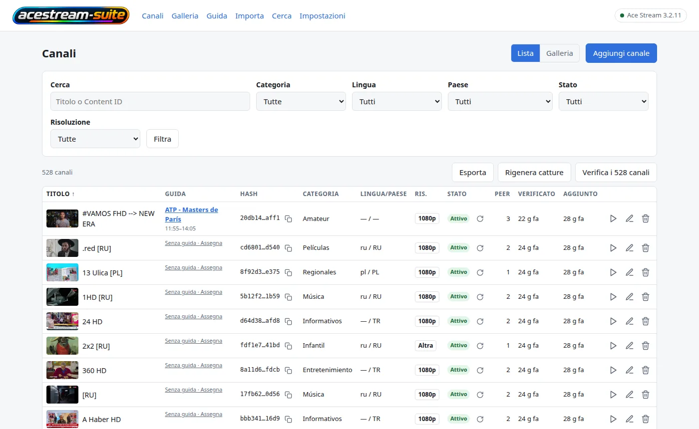
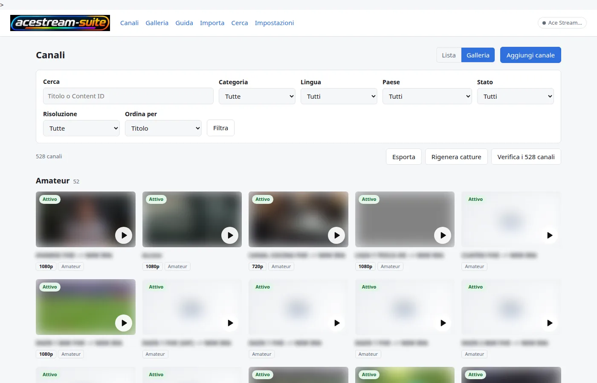
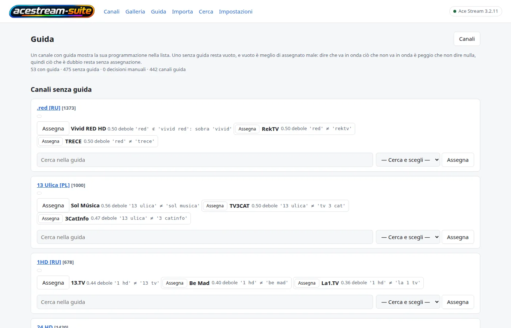
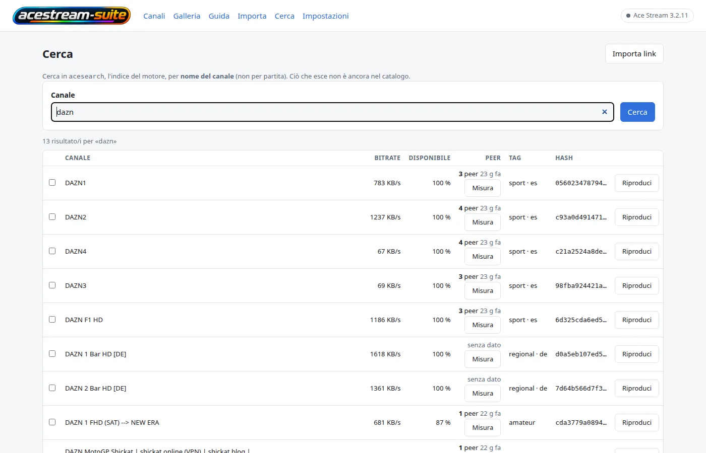
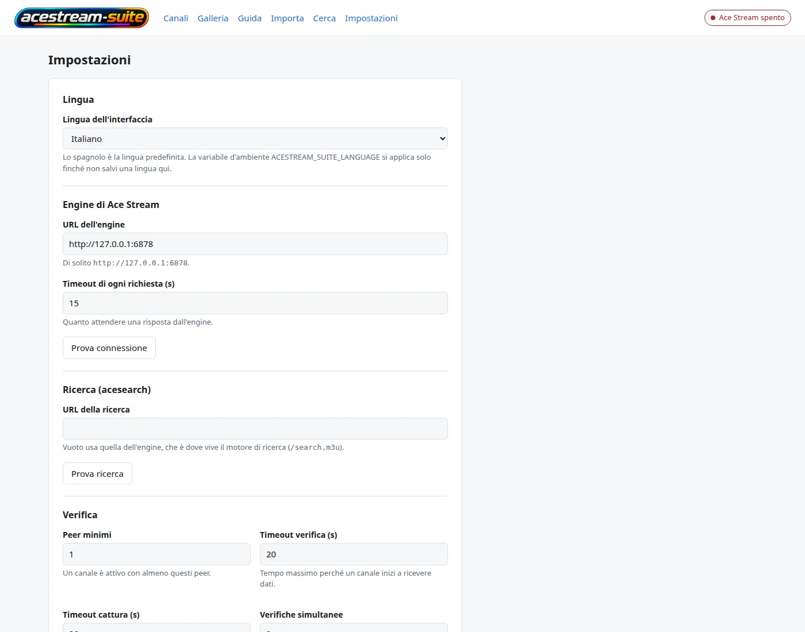

# acestream-suite

🇬🇧 [English](README.md) · 🇪🇸 [Español](README.es.md) · 🇫🇷 [Français](README.fr.md) · 🇮🇹 **Italiano** · 🇩🇪 [Deutsch](README.de.md) · 🇷🇺 [Русский](README.ru.md) · 🇨🇳 [中文](README.zh.md) · 🇯🇵 [日本語](README.ja.md)

<p align="center"></p>

**Origine.** L'idea e la base di questa applicazione vengono dal progetto **AceList**
(<https://github.com/fabiomb/AceList>): un catalogo locale di link AceStream. Questa suite è quell'idea
estesa con componenti propri, e `LICENSE` registra cosa questo comporta se la ridistribuisci.

Un front end web self-hosted per un motore **AceStream**. Tiene un catalogo di link `acestream://`
— canali con il loro Content ID, una verifica di disponibilità contro il motore, un fotogramma
catturato di ciascuno, categorie, lingue e paesi — e aggiunge quattro cose intorno a quel catalogo:

- **uno strato guida (EPG)**: sorgenti XMLTV, una mappatura canale↔guida, una finestra di programmi
  memorizzata, un documento XMLTV su `/epg.xml` e una playlist M3U che porta con sé la guida;
- **una pagina di ricerca** sull'indice proprio del motore (`acesearch`), così i canali che l'indice
  conosce e il catalogo no possono essere trovati e importati;
- **un bridge HLS** che trasforma uno stream del motore in un manifest che più lettori in casa
  possono guardare nello stesso momento;
- **script** che pubblicano il catalogo come playlist per i lettori che vogliono un URL invece di una
  pagina web (VLC, Kodi, Dispatcharr/Jellyfin Live TV, una smart TV).

`acestream-suite` è questo prodotto. **AceStream** è il motore attraverso cui riproduce: il motore è
software di terze parti e mantiene il proprio nome.

> **Nessuna autenticazione.** L'app è pensata per una rete privata. Chiunque possa raggiungere la
> porta può sfogliare il catalogo e avviare gli stream. Non pubblicarla su internet.

## Screenshot

<p align="center"></p>

L'interfaccia è disponibile in otto lingue. Il selettore in alto cambia il README; la lingua
dell'applicazione si sceglie in **Impostazioni** o con `ACESTREAM_SUITE_LANGUAGE` (`es`, `en`, `fr`,
`it`, `de`, `ru`, `zh`, `ja`). C'è uno screenshot per lingua in `assets/screenshots/`.

| Galleria | Guida | Cerca | Impostazioni |
|:---:|:---:|:---:|:---:|
|  |  |  |  |

## Avvio rapido (Docker)

Requisiti: Docker con Compose v2, e un motore AceStream raggiungibile via HTTP dal container (questa
suite non ne avvia uno).

```bash
git clone https://github.com/yerbajo/acestream-suite.git
cd acestream-suite
cp .env.example .env
$EDITOR .env                      # ACESTREAM_SUITE_ENGINE_URL, ACESTREAM_SUITE_ALLOWED_HOSTS
mkdir -p data && sudo chown 1000:1000 data
docker compose up -d --build
curl -fsS http://localhost:8080/health
```

Poi apri **`http://<host>:8080`** — `ACESTREAM_SUITE_PORT` in `.env` è la porta sull'host (`8080` se
non la cambi; l'app ascolta sempre su 8000 dentro il container). Il bridge HLS pubblica la **8084**.

Due dettagli che fanno danni se saltati:

- **`data/` deve esistere ed essere scrivibile da uid 1000.** Docker crea una sorgente bind mancante
  come directory vuota di proprietà di root e l'app gira come `"1000:1000"`, quindi non potrebbe
  scrivere il proprio database.
- **I valori di deployment vengono da `.env`, non dal file compose.** `docker-compose.yml` interpola
  ogni valore su cui un deployment differisce (`${ACESTREAM_SUITE_ENGINE_URL:-…}` e simili), quindi
  `cp .env.example .env` più una modifica bastano e il file compose non va mai toccato. Tutto ciò che
  lasci fuori da `.env` ricade sul default sicuro scritto nel compose. L'URL del motore, i suoi
  timeout, l'URL di ricerca e la concorrenza dei controlli sono anche *impostazioni salvate* nella
  pagina **Ajustes** dell'app, e un valore salvato vince sull'ambiente — quindi un `.env` sbagliato si
  corregge dalla UI senza ricostruire.

## L'immagine si costruisce in locale, da questo repository

`docker compose up -d --build` **costruisce** l'immagine; non viene scaricato nulla tranne la base
`python:3.12-slim` e i pacchetti della distro. Il codice dell'applicazione è qui: `app/` (l'app
FastAPI), `migrations/` (Alembic) e `pyproject.toml`, copiati nell'immagine e installati in modalità
editable, perché l'app legge i template, i file statici e le migrazioni relativamente all'albero dei
sorgenti.

`ffmpeg` è installato nell'immagine perché gli screenshot e la verifica di disponibilità leggono lo
stream live attraverso di esso.

Aggiornare:

```bash
git pull
docker compose build acestream-suite && docker compose up -d acestream-suite
```

Nominare il servizio conta: lo stesso file compose contiene anche il bridge `acestream-suite-hls`, e
un `docker compose up -d` senza nome ricreerebbe anche quello.

## Configurazione

Ogni variabile è letta dall'app dal suo ambiente. I nomi principali sono `ACESTREAM_SUITE_*`; i
vecchi nomi `ACELIST_*` sono ancora letti come fallback per una versione, così un deployment che non
è stato ancora rinominato continua a funzionare (il nome nuovo vince quando entrambi sono impostati).

| Variabile | Default | Cosa fa |
|---|---|---|
| `ACESTREAM_SUITE_ENGINE_URL` | `http://127.0.0.1:6878` | URL base dell'API HTTP del motore. Anche impostazione salvata. |
| `ACESTREAM_SUITE_ENGINE_TIMEOUT` | `15` | Secondi di attesa del motore prima che una chiamata sia considerata fallita. |
| `ACESTREAM_SUITE_SEARCH_URL` | vuoto = l'URL del motore | URL base di `acesearch`, l'indice che legge la pagina di ricerca (`/search.m3u`). Anche impostazione salvata. |
| `ACESTREAM_SUITE_ALLOWED_HOSTS` | vuoto | Valori `host` / `host:port` separati da virgola, accettati nell'header `Host` e nell'`Origin` di una scrittura. Senza l'indirizzo da cui navighi, ogni richiesta è un `400` e ogni scrittura un `403`. |
| `ACESTREAM_SUITE_PLAYBACK_MODE` | `vlc` | `vlc` avvia lo stream e apre un lettore locale (il comportamento desktop). `url` avvia lo stream e consegna il link alla pagina — la modalità di cui ha bisogno un container, che non ha un lettore. |
| `ACESTREAM_SUITE_STREAM_PARAM` | `id` | Parametro di query che avvia uno stream sul motore: `id` per la build Windows 3.1.x, `infohash` per la build Linux 3.2.x (che risponde `failed to load content` a `id`). |
| `ACESTREAM_SUITE_CHECK_CONCURRENCY` | `2` | Verifiche di disponibilità contemporanee. Ognuna è una sessione live sul motore, quindi questo è anche il carico sul motore. |
| `ACESTREAM_SUITE_SCREENSHOT_TIMEOUT` | `30` | Secondi concessi alla cattura del fotogramma con ffmpeg. |
| `ACESTREAM_SUITE_FFMPEG_PATH` | vuoto = `ffmpeg` nel `PATH` | Il binario usato per gli screenshot. |
| `ACESTREAM_SUITE_VLC_PATH` | vuoto = cartelle usuali, poi `PATH` | Letto solo in modalità di riproduzione `vlc`. |
| `ACESTREAM_SUITE_DATA_DIR` | `/data` nell'immagine, la directory app-data del sistema operativo altrove | Dove vivono `acestream-suite.db` e `screenshots/`. |
| `ACESTREAM_SUITE_PORT` | `8080` | Porta pubblicata sull'host. L'app ascolta sempre su `8000` dentro il container. |
| `ACESTREAM_SUITE_EPG_SOURCES` | `[]` | Sorgenti XMLTV, come lista JSON di URL. Vuoto è uno stato supportato: il catalogo funziona senza guida. |
| `ACESTREAM_SUITE_EPG_WINDOW_HOURS` | `72` | Quanto avanti rispetto a *adesso* viene mantenuta la guida; i programmi più vecchi vengono eliminati a ogni refresh. |
| `ACESTREAM_SUITE_EPG_TIMEOUT_SECONDS` | `120` | Timeout per sorgente del refresh. Una sorgente che non risponde mai costa una sorgente, non l'intera esecuzione. |
| `ACESTREAM_SUITE_EPG_MAX_MB` | `64` | Una sorgente più grande di così viene rifiutata invece di riempire la memoria del container. |
| `ACESTREAM_SUITE_EPG_GRACE_SECONDS` | `300` | Secondi extra in cui un programma appena finito viene mantenuto, per i lettori il cui orologio è indietro. |
| `ACESTREAM_SUITE_EPG_ACTOR` | vuoto = l'utente del sistema operativo | Nome registrato come autore di una decisione manuale canale↔guida. |

**Quali di queste `.env` può impostare lo decide il file compose.** Interpola `ENGINE_URL`,
`ALLOWED_HOSTS`, `PLAYBACK_MODE`, `STREAM_PARAM`, `CHECK_CONCURRENCY`, `PORT`, `EPG_SOURCES`,
`EPG_WINDOW_HOURS` e gli `HLS_ALIASES` del bridge — esattamente i nomi che
`.env.example` fornisce. Le altre sono lette dall'app ma non passate dal compose: sono o
impostazioni salvate in **Ajustes** (timeout del motore, URL di ricerca, timeout dei controlli, peer
minimi, timeout degli screenshot, percorso ffmpeg, percorso VLC) o valori che aggiungi tu a
`environment:` nel compose (directory dati, i timeout e il limite di dimensione della guida, il nome
dell'attore).

Due note:

- La frequenza del refresh della guida non è configurazione: è la schedulazione in
  `scripts/acestream-suite-guide-refresh.cron` (04:07 e 16:07), e niente nel container legge un
  intervallo. Cambia quella riga per cambiare la frequenza.
- Il file del database è `acestream-suite.db`, dentro la directory dati su cui l'app è puntata.

## Dati e backup

Tutto lo stato dell'applicazione è una directory, montata su `/data` e bindata a `./data` nel file
compose:

```
data/
  acestream-suite.db   SQLite: catalogue, check history, guide tables, settings
  screenshots/    one captured frame per channel
```

Per fare un backup, copia la directory mentre l'app non ci sta scrivendo:

```bash
docker compose stop acestream-suite
tar czf "acestream-suite-data-$(date +%F).tar.gz" data
docker compose start acestream-suite
```

Una copia presa da un container in esecuzione può cogliere il file SQLite a metà scrittura. Lo script
`acestream-suite-prune` (sotto) prende esattamente questo tipo di copia prima di cancellare qualcosa,
insieme a un export reimportabile dell'intero catalogo.

Per ripristinare: ferma l'app, sostituisci `data/`, avviala. L'entrypoint applica le migrazioni del
database all'avvio, quindi un backup di una versione più vecchia viene aggiornato invece che
rifiutato.

## Come è organizzato il codice sorgente

| Percorso | Cos'è |
|---|---|
| `app/` | L'applicazione web: route FastAPI, template, file statici, il client del motore, la guida e la ricerca. |
| `migrations/` + `alembic.ini` | Lo schema del database, applicato all'avvio del container da `entrypoint.sh`. |
| `tests/` | La suite di test dell'applicazione (pytest, ~640 test, nessuna rete): `pytest -q` dalla radice del repository. |
| `scripts/` | I job opzionali sull'host: i builder di playlist, l'importer del match-day, il prune, i loro file `.cron` e `crons-install.sh`. |
| `assets/` | Il logo e la favicon che l'immagine copia nella directory statica dell'app. |

La provenienza, e cosa comporta per te, è in `LICENSE`.

## Il bridge HLS

I motori della linea 3.2.x non servono un manifest HLS, e diversi client (smart TV, Dispatcharr,
Jellyfin Live TV) ne vogliono uno. `acestream-suite-hls` — il secondo servizio nello stesso file
compose, dalla stessa immagine — rimuxa l'MPEG-TS del motore, senza ricodifica, in segmenti da 2
secondi e serve:

```
http://<host>:8084/<infohash>/index.m3u8
```

Un `ffmpeg` per canale, al massimo quattro sessioni, una sessione chiusa 45 secondi dopo l'ultima
richiesta, la finestra dei segmenti in un tmpfs da 2 GB, e la sessione sul motore rilasciata quando il
bridge lascia andare un canale. Quando lo spazio libero nel tmpfs scende sotto `HLS_MIN_FREE_MB`
chiude la sessione che occupa più byte: un tmpfs pieno rompe tutte le sessioni insieme, non solo una.
`python3 hls-bridge.py --self-test` verifica queste decisioni offline, con un motore finto e un ffmpeg
finto.

Il bridge è un workaround per un limite misurato del motore, non una preferenza: il motore serve un
solo lettore per contenuto, quindi puntargli contro più lettori direttamente li fa competere per lo
stesso canale.

## Gli script interni (opzionali)

Nulla in `scripts/` è necessario per eseguire l'app. Sono lo strato di pubblicazione che l'autore usa,
si aspettano i percorsi in testa a ogni file, e usano come default gli host di quel deployment
(`http://127.0.0.1:8083` per l'app, `/srv/www/varios` per le playlist). Ogni percorso e URL è un flag
e, per quelli che un host sposta, una variabile d'ambiente — leggi l'intestazione dello script che
stai per installare.

| Script | Cosa scrive |
|---|---|
| `acestream-suite-playlist.py` | Cinque file M3U nella directory web: `acestream-suite.m3u` (tutto), `deportes.m3u`, `espana.m3u`, `hls.m3u` (con una cartella `Campeones`) e `direct.m3u` (l'MPEG-TS del motore stesso). Solo canali che l'app ha verificato come attivi, una voce per nome visualizzato, ogni URL attraverso il bridge HLS tranne `direct.m3u`. Scrive solo quando il contenuto è cambiato. |
| `acestream-suite-guide-playlist.py` | `acestream-suite-guide.m3u`: lo stesso catalogo con `url-tvg` nell'header e l'id del canale guida come `tvg-id`, per i canali che ne hanno uno. |
| `acestream-suite-prune.py` | Una pulizia one-shot: aspetta che ogni canale sia stato controllato, fa un backup in `/backup/…/<stamp>/` (playlist, un export reimportabile del catalogo, una copia del database, la lista delle cancellazioni), poi cancella i canali la cui ultima verifica non era attiva, attraverso l'API dell'app stessa. Si marca come fatto; `--undo-guard` gli permette di girare di nuovo. |
| `crons-install.sh` | Il crontab di root sull'host di destinazione, generato da `scripts/*.cron`. `--dry-run` stampa, `--diff` confronta con il crontab live, `--install` fa il backup e scrive. Il suo array `JOBS` porta anche job di altri stack — leggilo prima di installare. |

Tutti accettano `--dry-run`; i due script delle playlist accettano anche `--self-test`, che esegue i
loro controlli senza rete e senza file. I job delle playlist hanno bisogno di un web server che serva
quella directory; `acestream-suite-guide-refresh.cron` è il refresh della guida, e lo esegue dentro il
container (`docker exec acestream-suite python3 -m app.cli epg-refresh`).

## Documentazione

- Otto lingue: il selettore in alto collega questo documento in inglese, spagnolo, francese, tedesco, russo, cinese e giapponese.
- `LICENSE` — MIT per il lavoro scritto qui, e la provenienza del codice dell'applicazione.
- Inline: ogni modulo porta una docstring che dice cosa decide e perché; `python -m app.cli --help` e
  l'`--help` di ogni script documentano le proprie opzioni.

## Licenza e note su terze parti

Il lavoro scritto qui — i file di deployment, gli script, la documentazione, il logo e il codice
dell'applicazione — è sotto licenza MIT; vedi `LICENSE`. Lo stesso file registra da dove vengono
l'idea e la base: **AceList** (<https://github.com/fabiomb/AceList>), che non pubblica una licenza
propria, e cosa questo comporta per la ridistribuzione. Dice anche da dove viene il marchio AceStream
dentro il logo. Leggilo prima di ridistribuire un'immagine costruita qui. L'immagine installa anche
software di terze parti: `python:3.12-slim`, i pacchetti Debian (`ffmpeg`, `curl`), e le dipendenze
Python in `pyproject.toml`, ognuna sotto la propria licenza; `htmx` (BSD-2-Clause) e i tratti delle
icone Lucide (ISC) sono vendored in `app/web/`.

## Come viene distribuito qui

**Questo repository è la suite, non il motore.** Un motore AceStream è una dipendenza verso cui la
punti: va bene qualsiasi motore la cui API HTTP sia raggiungibile dal container, e dove gira il
motore dell'autore — un'altra macchina, dentro una VPN, dietro un proxy — è fuori da questo
repository e irrilevante per esso. La suite presuppone solo che l'URL in `ACESTREAM_SUITE_ENGINE_URL`
risponda.

Quello che questo repository descrive è un deployment piccolo e ordinario: un host che esegue
`docker compose up -d`, i suoi valori in `.env`, un web server o reverse proxy che pubblica la
directory in cui scrive lo script delle playlist, e — se vuoi che le liste e la guida siano aggiornate
con una schedulazione — i job cron qui sopra. Il file compose è l'interfaccia, le variabili d'ambiente
qui sopra sono le manopole, e gli script in `scripts/` sono helper opzionali che puoi leggere,
eseguire a mano o schedulare.
