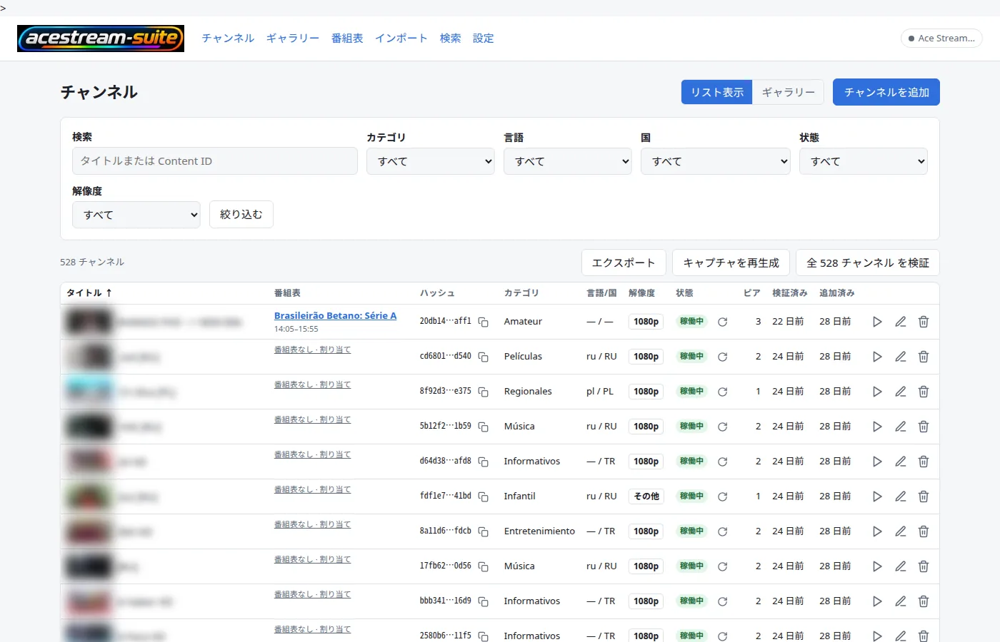
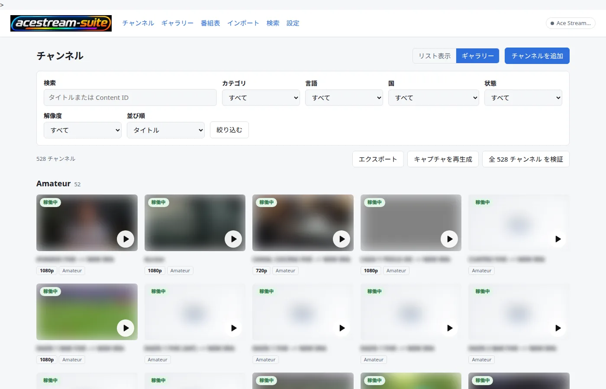
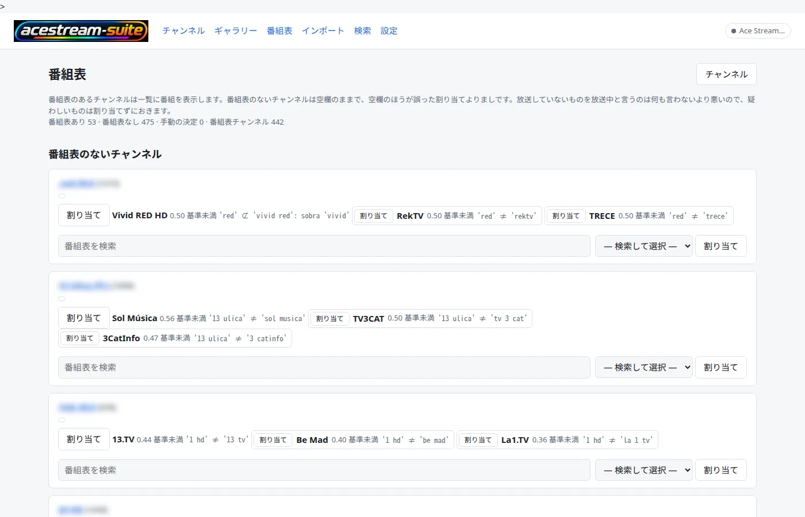
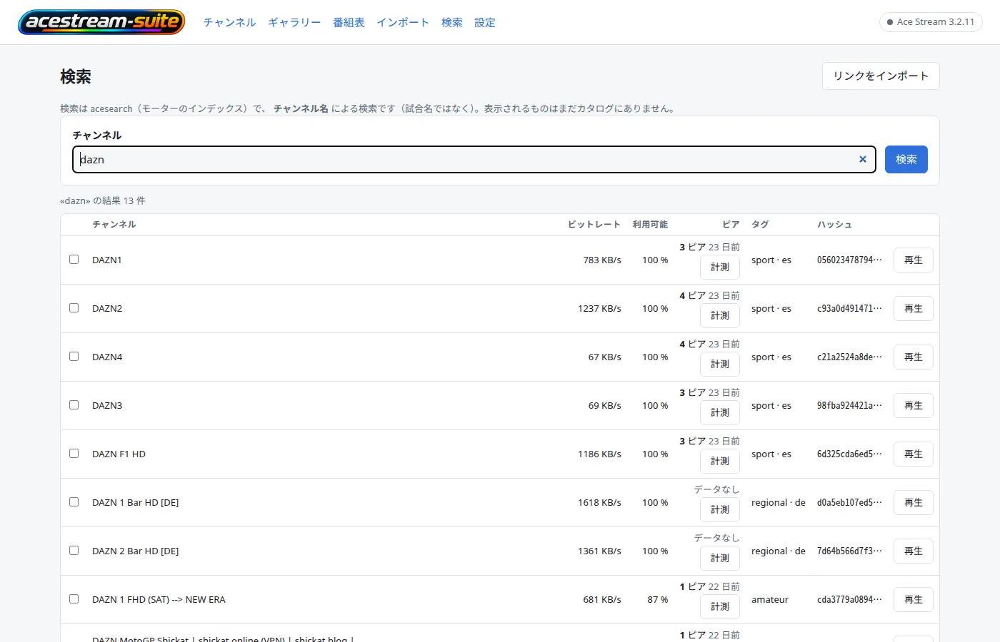
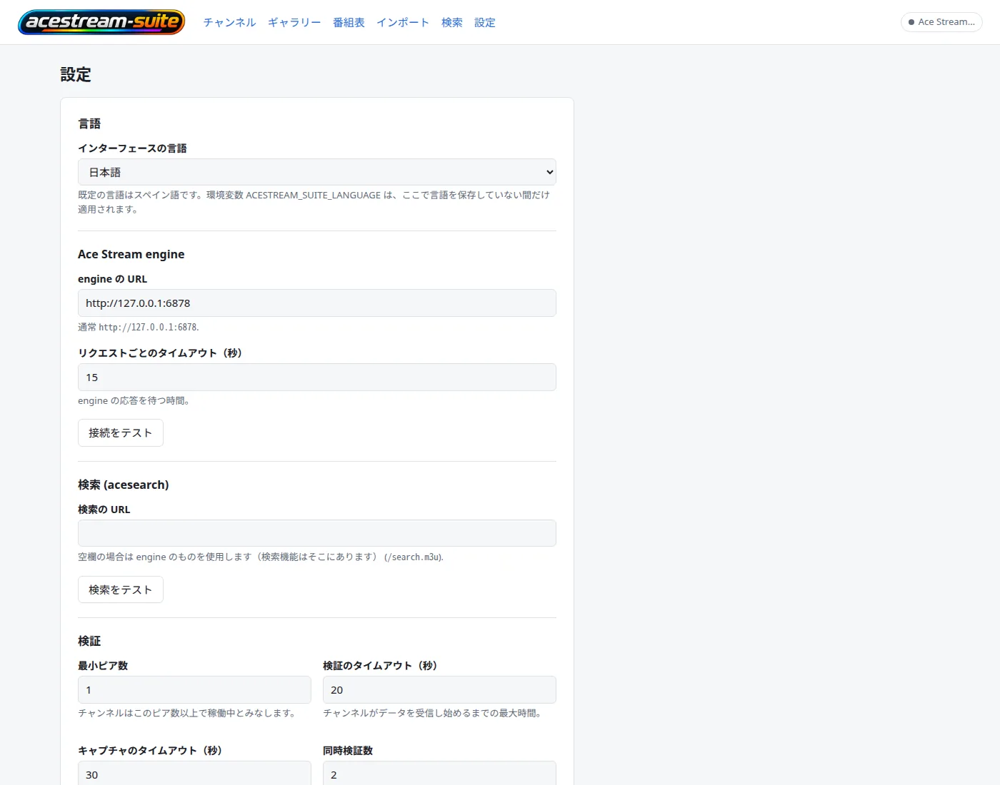

# acestream-suite

🇬🇧 [English](README.md) · 🇪🇸 [Español](README.es.md) · 🇫🇷 [Français](README.fr.md) · 🇮🇹 [Italiano](README.it.md) · 🇩🇪 [Deutsch](README.de.md) · 🇷🇺 [Русский](README.ru.md) · 🇨🇳 [中文](README.zh.md) · 🇯🇵 **日本語**

<p align="center"></p>

**起源。** このアプリケーションのアイデアと土台は **AceList** プロジェクト
（<https://github.com/fabiomb/AceList>）にあります。AceList は AceStream リンクのローカルな
カタログです。本スイートはそのアイデアを独自のコンポーネントで拡張したもので、再配布するときに
それが何を意味するかは `LICENSE` に記録されています。

**AceStream** エンジンのためのセルフホスト型 Web フロントエンドです。`acestream://` リンクの
カタログを維持します —— チャンネルとその Content ID、エンジンに対する可用性チェック、各チャンネル
からキャプチャした 1 フレーム、カテゴリ、言語、国 —— そしてそのカタログの周りに 4 つのものを
追加します：

- **ガイド（EPG）レイヤー**：XMLTV ソース、チャンネルとガイドの対応付け、保存された番組の時間枠、
  `/epg.xml` の XMLTV ドキュメント、そしてガイドを運ぶ M3U プレイリスト。
- **検索ページ**：エンジン自身のインデックス（`acesearch`）に対する検索。インデックスが知っていて
  カタログにないチャンネルを見つけて取り込めます。
- **HLS ブリッジ**：1 本のエンジンストリームを、家庭内の複数のプレイヤーが同時に視聴できる
  マニフェストに変換します。
- **スクリプト**：Web ページではなく URL を必要とするプレイヤー（VLC、Kodi、Dispatcharr/Jellyfin
  Live TV、スマート TV）向けに、カタログをプレイリストとして公開します。

`acestream-suite` はこの製品です。**AceStream** はそれが再生に使うエンジンです。エンジンは
サードパーティ製ソフトウェアであり、独自の名前を保ちます。

> **認証はありません。** このアプリはプライベートネットワーク向けです。ポートに到達できる人は
> 誰でもカタログを閲覧し、ストリームを開始できます。インターネットに公開しないでください。

## スクリーンショット

<p align="center"></p>

インターフェースは8言語に対応しています。ページ上部の切り替えはREADMEを切り替えるもので、アプリ
本体の言語は**設定**または `ACESTREAM_SUITE_LANGUAGE` で選びます（`es`, `en`, `fr`, `it`, `de`,
`ru`, `zh`, `ja`）。言語ごとのスクリーンショットは `assets/screenshots/` にあります。

| ギャラリー | 番組表 | 検索 | 設定 |
|:---:|:---:|:---:|:---:|
|  |  |  |  |

## クイックスタート（Docker）

要件：Compose v2 付きの Docker と、コンテナから HTTP で到達できる AceStream エンジン（本スイートは
エンジンを起動しません）。

```bash
git clone https://github.com/yerbajo/acestream-suite.git
cd acestream-suite
cp .env.example .env
$EDITOR .env                      # ACESTREAM_SUITE_ENGINE_URL, ACESTREAM_SUITE_ALLOWED_HOSTS
mkdir -p data && sudo chown 1000:1000 data
docker compose up -d --build
curl -fsS http://localhost:8080/health
```

次に **`http://<host>:8080`** を開きます —— `.env` の `ACESTREAM_SUITE_PORT` がホスト側のポートです
（変更しなければ `8080`。アプリはコンテナ内では常に 8000 で待ち受けます）。HLS ブリッジは
**8084** を公開します。

省略すると問題になる 2 点：

- **`data/` は存在し、uid 1000 から書き込み可能でなければなりません。** Docker は存在しない
  バインド元を root 所有の空ディレクトリとして作成し、アプリは `"1000:1000"` で動作するため、
  データベースに書き込めません。
- **デプロイの値は compose ファイルではなく `.env` から来ます。** `docker-compose.yml` はデプロイ
  ごとに異なるすべての値（`${ACESTREAM_SUITE_ENGINE_URL:-…}` など）を展開するので、
  `cp .env.example .env` と編集だけで足り、compose ファイル自体に触れる必要はありません。`.env` に
  書かなかったものは、compose に書かれた安全な既定値にフォールバックします。エンジン URL、その
  タイムアウト、検索 URL、チェックの同時実行数はアプリの **Ajustes** ページの*保存設定*でもあり、
  保存された値が環境変数より優先されます。したがって、間違った `.env` は再ビルドせずに UI から
  修正できます。

## イメージはこのリポジトリからローカルでビルドされる

`docker compose up -d --build` はイメージを**ビルド**します。取得されるのはベースの
`python:3.12-slim` とディストリビューションのパッケージだけです。アプリケーションのソースはここに
あります：`app/`（FastAPI アプリ）、`migrations/`（Alembic）、`pyproject.toml`。これらはイメージに
コピーされ、編集可能モードでインストールされます。アプリはテンプレート、静的ファイル、
マイグレーションをソースツリーからの相対パスで読むためです。

`ffmpeg` はイメージにインストールされています。スクリーンショットと可用性チェックがそれを介して
ライブストリームを読むためです。

更新：

```bash
git pull
docker compose build acestream-suite && docker compose up -d acestream-suite
```

サービス名の指定が重要です。同じ compose ファイルには `acestream-suite-hls` ブリッジも含まれており、
単なる `docker compose up -d` はそれも再作成してしまいます。

## 設定

すべての変数はアプリが環境から読み取ります。主要な名前は `ACESTREAM_SUITE_*` です。古い
`ACELIST_*` 名も 1 バージョンの間フォールバックとして読まれるため、まだ名前を変更していないデプロイ
も動作し続けます（両方設定されている場合は新しい名前が優先されます）。

| 変数 | 既定値 | 何をするか |
|---|---|---|
| `ACESTREAM_SUITE_ENGINE_URL` | `http://127.0.0.1:6878` | エンジン HTTP API のベース URL。保存設定でもあります。 |
| `ACESTREAM_SUITE_ENGINE_TIMEOUT` | `15` | 呼び出しを失敗と判定するまでエンジンを待つ秒数。 |
| `ACESTREAM_SUITE_SEARCH_URL` | 空 = エンジン URL | 検索ページが読むインデックス `acesearch` のベース URL（`/search.m3u`）。保存設定でもあります。 |
| `ACESTREAM_SUITE_ALLOWED_HOSTS` | 空 | `Host` ヘッダーと書き込みの `Origin` で受け付ける `host` / `host:port` のカンマ区切りリスト。閲覧に使うアドレスが含まれていないと、すべてのリクエストが `400`、すべての書き込みが `403` になります。 |
| `ACESTREAM_SUITE_PLAYBACK_MODE` | `vlc` | `vlc` はストリームを開始してローカルプレイヤーを開きます（デスクトップの動作）。`url` はストリームを開始してリンクをページに渡します —— プレイヤーを持たないコンテナに必要なモードです。 |
| `ACESTREAM_SUITE_STREAM_PARAM` | `id` | エンジンでストリームを開始するクエリパラメータ：Windows 3.1.x ビルドは `id`、Linux 3.2.x ビルドは `infohash`（`id` には `failed to load content` を返します）。 |
| `ACESTREAM_SUITE_CHECK_CONCURRENCY` | `2` | 同時に行う可用性チェック数。それぞれが実際のエンジンセッションなので、エンジンへの負荷でもあります。 |
| `ACESTREAM_SUITE_SCREENSHOT_TIMEOUT` | `30` | ffmpeg のフレームキャプチャに許される秒数。 |
| `ACESTREAM_SUITE_FFMPEG_PATH` | 空 = `PATH` 上の `ffmpeg` | スクリーンショットに使うバイナリ。 |
| `ACESTREAM_SUITE_VLC_PATH` | 空 = 通常のフォルダ、次に `PATH` | `vlc` 再生モードでのみ読み取られます。 |
| `ACESTREAM_SUITE_DATA_DIR` | イメージ内では `/data`、それ以外では OS のアプリデータディレクトリ | `acestream-suite.db` と `screenshots/` の場所。 |
| `ACESTREAM_SUITE_PORT` | `8080` | ホストで公開するポート。アプリはコンテナ内では常に `8000` で待ち受けます。 |
| `ACESTREAM_SUITE_EPG_SOURCES` | `[]` | XMLTV ソース。URL の JSON リスト。空もサポートされる状態です：カタログはガイドなしで動作します。 |
| `ACESTREAM_SUITE_EPG_WINDOW_HOURS` | `72` | ガイドを*現在*からどれだけ先まで保持するか。古い番組はリフレッシュが走るたびに削除されます。 |
| `ACESTREAM_SUITE_EPG_TIMEOUT_SECONDS` | `120` | リフレッシュのソースごとのタイムアウト。応答しないソースのコストは、実行全体ではなくそのソース 1 つ分です。 |
| `ACESTREAM_SUITE_EPG_MAX_MB` | `64` | これより大きいソースは、コンテナのメモリを埋める代わりに拒否されます。 |
| `ACESTREAM_SUITE_EPG_GRACE_SECONDS` | `300` | 終了したばかりの番組を余分に保持する秒数。時計が遅れているプレイヤーのためです。 |
| `ACESTREAM_SUITE_EPG_ACTOR` | 空 = OS ユーザー | 手動のチャンネル↔ガイド判断の作者として記録される名前。 |

**`.env` が設定できるのはどれかは compose ファイルが決めます。** それは `ENGINE_URL`、
`ALLOWED_HOSTS`、`PLAYBACK_MODE`、`STREAM_PARAM`、`CHECK_CONCURRENCY`、`PORT`、`EPG_SOURCES`、
`EPG_WINDOW_HOURS`、そしてブリッジの `HLS_ALIASES` を展開します —— `.env.example` が出荷する名前と
ちょうど同じです。残りはアプリが読みますが compose は渡しません：**Ajustes** の保存設定（エンジン
タイムアウト、検索 URL、チェックタイムアウト、最小ピア数、スクリーンショットタイムアウト、ffmpeg
パス、VLC パス）であるか、compose の `environment:` に自分で追加する値（データディレクトリ、ガイド
のタイムアウトとサイズ上限、作者名）です。

2 つの注意点：

- ガイドの更新頻度は設定ではありません：`scripts/acestream-suite-guide-refresh.cron` のスケジュール
  （04:07 と 16:07）であり、コンテナ内の何も間隔を読みません。頻度を変えるにはその行を変更します。
- データベースファイルは `acestream-suite.db` で、アプリが指定されたデータディレクトリの中に
  あります。

## データとバックアップ

アプリケーションの状態全体は 1 つのディレクトリで、`/data` にマウントされ、compose ファイルで
`./data` にバインドされています：

```
data/
  acestream-suite.db   SQLite: catalogue, check history, guide tables, settings
  screenshots/    one captured frame per channel
```

バックアップするには、アプリが書き込みを行っていない間にディレクトリをコピーします：

```bash
docker compose stop acestream-suite
tar czf "acestream-suite-data-$(date +%F).tar.gz" data
docker compose start acestream-suite
```

実行中のコンテナから取ったコピーは、SQLite ファイルが書き込み中である瞬間を捉える可能性があります。
`acestream-suite-prune` スクリプト（後述）は、何かを削除する前に、カタログ全体の再インポート可能な
エクスポートと一緒に、まさにこの種のコピーを取得します。

復元するには：アプリを停止し、`data/` を置き換え、起動します。エントリポイントは起動時に
データベースのマイグレーションを適用するので、古いバージョンのバックアップは拒否されるのでは
なくアップグレードされます。

## ソースの構成

| パス | 何か |
|---|---|
| `app/` | Web アプリケーション：FastAPI のルート、テンプレート、静的ファイル、エンジンクライアント、ガイド、検索。 |
| `migrations/` + `alembic.ini` | データベーススキーマ。`entrypoint.sh` がコンテナ起動時に適用します。 |
| `tests/` | アプリケーションのテストスイート（pytest、約 640 テスト、ネットワーク不要）：リポジトリルートで `pytest -q`。 |
| `scripts/` | 任意のホストジョブ：プレイリスト生成、試合日インポーター、prune、それらの `.cron` ファイルと `crons-install.sh`。 |
| `assets/` | イメージがアプリの静的ディレクトリにコピーするロゴと favicon。 |

来歴と、それがあなたにとって何を意味するかは `LICENSE` にあります。

## HLS ブリッジ

3.2.x 系のエンジンは HLS マニフェストを配信せず、いくつかのクライアント（スマート TV、Dispatcharr、
Jellyfin Live TV）はそれを必要とします。`acestream-suite-hls` —— 同じ compose ファイルの 2 つ目の
サービスで、同じイメージから作られます —— は、エンジンの MPEG-TS を再エンコードせずに 2 秒の
セグメントにリマックスし、次を配信します：

```
http://<host>:8084/<infohash>/index.m3u8
```

チャンネルごとに `ffmpeg` が 1 つ、セッションは最大 4 つ、最後のリクエストから 45 秒後にセッションを
閉じ、セグメントのウィンドウは 2 GB の tmpfs に置き、ブリッジがチャンネルを手放すとエンジン
セッションを解放します。tmpfs の空き容量が `HLS_MIN_FREE_MB` を下回ると、最も多くのバイトを保持する
セッションを閉じます：tmpfs がいっぱいになると、1 つのセッションではなくすべてのセッションが一度に
壊れるためです。`python3 hls-bridge.py --self-test` は、偽のエンジンと偽の ffmpeg を使ってこれらの
判断をオフラインで検証します。

ブリッジは測定されたエンジンの制約への回避策であり、好みではありません：エンジンはコンテンツごとに
1 人の読者にしか配信しないため、複数のプレイヤーを直接向けると同じチャンネルを奪い合うことになり
ます。

## 家庭用スクリプト（任意）

`scripts/` のどれもアプリの実行には不要です。これらは作者が使う公開レイヤーで、各ファイルの先頭に
書かれたパスを前提とし、既定ではそのデプロイ自身のホスト（アプリは `http://127.0.0.1:8083`、
プレイリストは `/srv/www/varios`）を使います。すべてのパスと URL はフラグであり、ホストが移動する
ものについては環境変数でもあります —— インストールしようとしているスクリプトのヘッダーを読んで
ください。

| スクリプト | 書き出すもの |
|---|---|
| `acestream-suite-playlist.py` | Web ディレクトリに 5 つの M3U ファイル：`acestream-suite.m3u`（すべて）、`deportes.m3u`、`espana.m3u`、`hls.m3u`（`Campeones` フォルダ付き）、そして `direct.m3u`（エンジン自身の MPEG-TS）。アプリが生きていると検証したチャンネルのみ、表示名ごとに 1 エントリ、`direct.m3u` 以外のすべての URL は HLS ブリッジ経由。内容が変わったときだけ書き込みます。 |
| `acestream-suite-guide-playlist.py` | `acestream-suite-guide.m3u`：同じカタログで、ヘッダーに `url-tvg`、ガイドチャンネル id を `tvg-id` として持つもの。それを持つチャンネルのみ。 |
| `acestream-suite-prune.py` | 一回限りのクリーンアップ：すべてのチャンネルがチェックされるまで待ち、`/backup/…/<stamp>/` にバックアップし（プレイリスト、再インポート可能なカタログのエクスポート、データベースのコピー、削除リスト）、その後アプリ自身の API を通じて、最後のチェックが生きていなかったチャンネルを削除します。自身を完了とマークします；`--undo-guard` で再度実行できます。 |
| `crons-install.sh` | 対象ホストの root の crontab。`scripts/*.cron` から生成。`--dry-run` は表示、`--diff` は稼働中の crontab と比較、`--install` はバックアップして書き込みます。その `JOBS` 配列には他のスタックのジョブも含まれるので、インストール前に読んでください。 |

すべて `--dry-run` を受け付けます。2 つのプレイリストスクリプトは `--self-test` も受け付け、
ネットワークもファイルも使わずにチェックを実行します。プレイリストのジョブにはそのディレクトリを
配信する Web サーバーが必要です。`acestream-suite-guide-refresh.cron` はガイドのリフレッシュで、
コンテナ内で実行します（`docker exec acestream-suite python3 -m app.cli epg-refresh`）。

## ドキュメント

- 8言語対応：ページ上部の切り替えから、この文書の英語・スペイン語・フランス語・イタリア語・ドイツ語・ロシア語・中国語版を開けます。
- `LICENSE` — ここで著作された部分は MIT、およびアプリケーションコードの来歴。
- インライン：すべてのモジュールは、何をなぜ判断するかを述べる docstring を持っています。
  `python -m app.cli --help` と各スクリプトの `--help` が自分のオプションを説明します。

## ライセンスと第三者への表示

ここで著作された部分 —— デプロイファイル、スクリプト、ドキュメント、ロゴ、アプリケーションコード
—— は MIT ライセンスです。`LICENSE` を参照してください。同じファイルに、アイデアと土台がどこから
来たかが記録されています：**AceList**（<https://github.com/fabiomb/AceList>）は自前のライセンスを
公開しておらず、それが再配布にとって何を意味するかも書かれています。ロゴ内の AceStream マークが
どこから来たかも書かれています。ここでビルドしたイメージを再配布する前に読んでください。イメージは
サードパーティ製ソフトウェアもインストールします：`python:3.12-slim`、Debian パッケージ（`ffmpeg`、
`curl`）、そして `pyproject.toml` の Python 依存関係で、それぞれが独自のライセンスに従います；
`htmx`（BSD-2-Clause）と Lucide のアイコンストローク（ISC）は `app/web/` にベンダリングされて
います。

## ここでのデプロイ方法

**このリポジトリはスイートであり、エンジンではありません。** AceStream エンジンは、こちらが
指し示す依存先です：コンテナが HTTP API に到達できるエンジンなら何でも動作し、作者自身のエンジンが
どこで動いているか —— 別のマシン、VPN の内側、プロキシの背後 —— はこのリポジトリの外にあり、
無関係です。スイートは `ACESTREAM_SUITE_ENGINE_URL` の URL が応答することだけを前提とします。

このリポジトリが説明するのは、小さく普通のデプロイです：`docker compose up -d` を実行する 1 台の
ホスト、その値は `.env` に、プレイリストスクリプトが書き出すディレクトリを配信する Web サーバー
またはリバースプロキシ、そして —— リストとガイドをスケジュールで更新したいなら —— 上記の cron
ジョブです。compose ファイルがインターフェースで、上記の環境変数がつまみで、`scripts/` の
スクリプトは読んだり手で実行したりスケジュールしたりできる任意の補助です。
