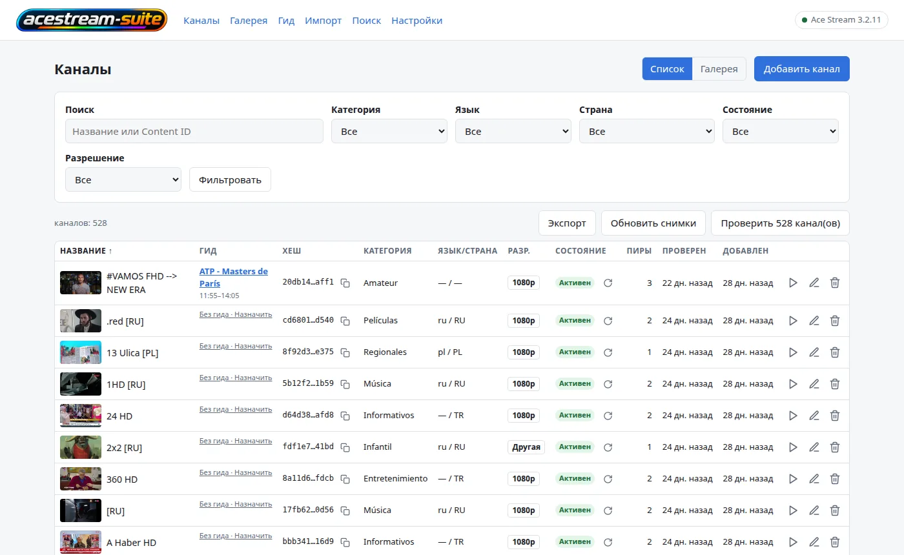
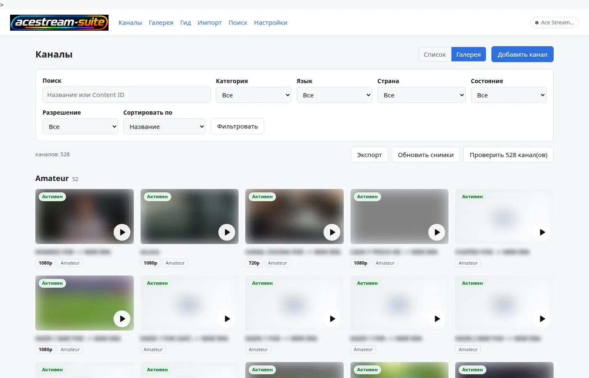
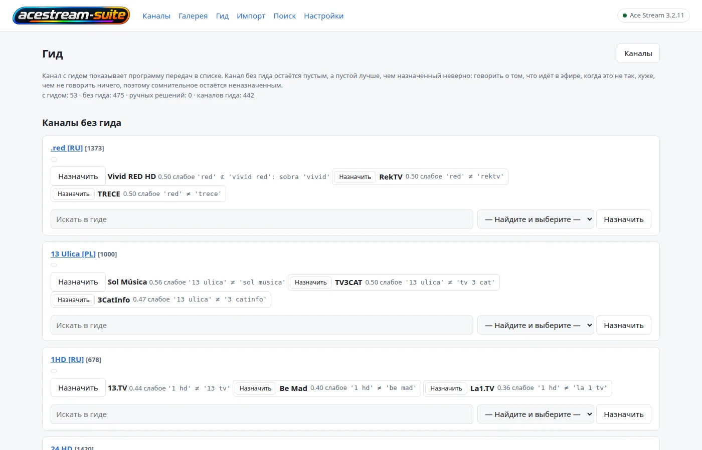
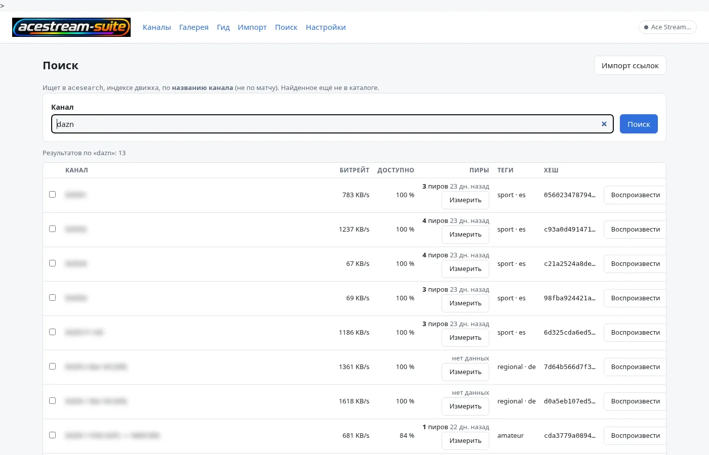
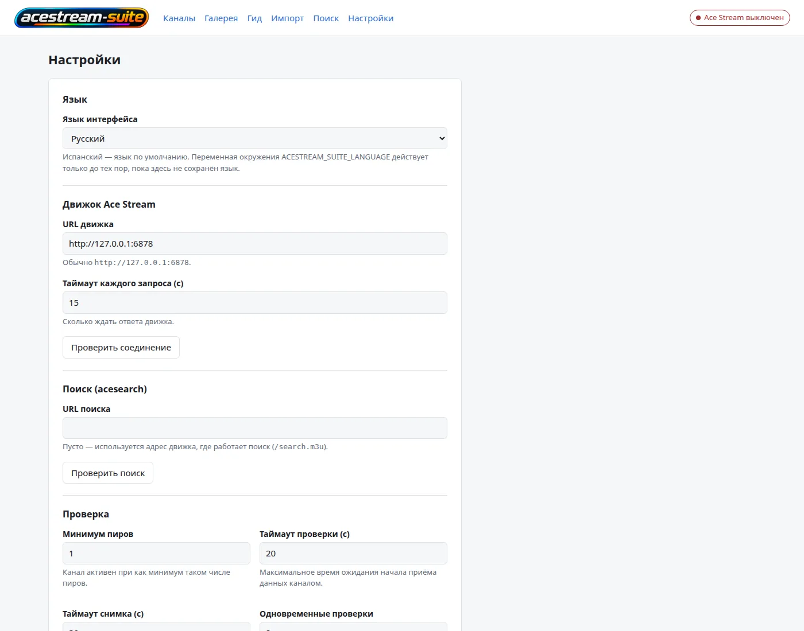

# acestream-suite

🇬🇧 [English](README.md) · 🇪🇸 [Español](README.es.md) · 🇫🇷 [Français](README.fr.md) · 🇮🇹 [Italiano](README.it.md) · 🇩🇪 [Deutsch](README.de.md) · 🇷🇺 **Русский** · 🇨🇳 [中文](README.zh.md) · 🇯🇵 [日本語](README.ja.md)

<p align="center"></p>

**Происхождение.** Идея и основа этого приложения взяты из проекта **AceList**
(<https://github.com/fabiomb/AceList>): локальный каталог ссылок AceStream. Этот набор — та же идея,
расширенная собственными компонентами, и `LICENSE` фиксирует, что это значит при распространении.

Самохостинговый веб-интерфейс к движку **AceStream**. Он ведёт каталог ссылок `acestream://` —
каналы с их Content ID, проверка доступности через движок, захваченный кадр каждого из них,
категории, языки и страны — и добавляет вокруг этого каталога четыре вещи:

- **слой телепрограммы (EPG)**: источники XMLTV, сопоставление канал↔программа, хранимое окно
  передач, документ XMLTV по адресу `/epg.xml` и плейлист M3U, который несёт эту телепрограмму;
- **страница поиска** по собственному индексу движка (`acesearch`), чтобы находить и импортировать
  каналы, которые индекс знает, а каталог — нет;
- **HLS-мост**, превращающий один поток движка в манифест, который несколько плееров в доме могут
  смотреть одновременно;
- **скрипты**, публикующие каталог в виде плейлистов для плееров, которым нужен URL, а не
  веб-страница (VLC, Kodi, Dispatcharr/Jellyfin Live TV, Smart TV).

`acestream-suite` — это продукт. **AceStream** — движок, через который он играет: движок является
сторонним ПО и сохраняет своё имя.

> **Аутентификации нет.** Приложение рассчитано на приватную сеть. Любой, кто может достучаться до
> порта, может просматривать каталог и запускать потоки. Не публикуйте его в интернет.

## Скриншоты

<p align="center"></p>

Интерфейс переведён на восемь языков. Переключатель выше меняет сам README; язык приложения
выбирается в **Настройках** или переменной `ACESTREAM_SUITE_LANGUAGE` (`es`, `en`, `fr`, `it`, `de`,
`ru`, `zh`, `ja`). По одному скриншоту на язык лежит в `assets/screenshots/`.

| Галерея | Гид | Поиск | Настройки |
|:---:|:---:|:---:|:---:|
|  |  |  |  |

## Быстрый старт (Docker)

Требования: Docker с Compose v2 и движок AceStream, доступный по HTTP из контейнера (этот набор его
не запускает).

```bash
git clone https://github.com/yerbajo/acestream-suite.git
cd acestream-suite
cp .env.example .env
$EDITOR .env                      # ACESTREAM_SUITE_ENGINE_URL, ACESTREAM_SUITE_ALLOWED_HOSTS
mkdir -p data && sudo chown 1000:1000 data
docker compose up -d --build
curl -fsS http://localhost:8080/health
```

Затем откройте **`http://<host>:8080`** — `ACESTREAM_SUITE_PORT` в `.env` задаёт порт на хосте
(`8080`, если вы его не меняли; внутри контейнера приложение всегда слушает 8000). HLS-мост
публикует **8084**.

Две детали, которые дадут о себе знать, если их пропустить:

- **`data/` должен существовать и быть доступным на запись для uid 1000.** Docker создаёт
  отсутствующий источник bind-монтирования как пустой каталог, принадлежащий root, а приложение
  работает как `"1000:1000"`, поэтому записать свою базу данных оно не смогло бы.
- **Значения для развёртывания берутся из `.env`, а не из compose-файла.** `docker-compose.yml`
  интерполирует каждое значение, которым различаются развёртывания (`${ACESTREAM_SUITE_ENGINE_URL:-…}`
  и прочие), так что `cp .env.example .env` плюс правка — этого достаточно, и сам compose-файл
  трогать никогда не нужно. Всё, что вы не указали в `.env`, откатывается к безопасному значению по
  умолчанию, записанному в compose. URL движка, его таймауты, URL поиска и параллелизм проверок —
  это ещё и *сохраняемые настройки* на странице приложения **Ajustes**, а сохранённое значение
  важнее окружения — так что неверный `.env` можно исправить из интерфейса, без пересборки.

## Образ собирается локально, из этого репозитория

`docker compose up -d --build` **собирает** образ; не скачивается ничего, кроме базового
`python:3.12-slim` и пакетов дистрибутива. Исходный код приложения находится здесь: `app/`
(приложение на FastAPI), `migrations/` (Alembic) и `pyproject.toml` — он копируется в образ и
устанавливается в editable-режиме, потому что приложение читает свои шаблоны, статические файлы и
миграции относительно дерева исходников.

`ffmpeg` устанавливается в образ, потому что скриншоты и проверка доступности читают живой поток
через него.

Обновление:

```bash
git pull
docker compose build acestream-suite && docker compose up -d acestream-suite
```

Указывать сервис важно: тот же compose-файл содержит ещё и мост `acestream-suite-hls`, и голый
`docker compose up -d` пересоздал бы и его.

## Конфигурация

Каждая переменная читается приложением из его окружения. Основные имена — `ACESTREAM_SUITE_*`;
старые имена `ACELIST_*` ещё читаются как запасной вариант в течение одной версии, так что
развёртывание, которое ещё не переименовано, продолжает работать (при установке обоих побеждает
новое имя).

| Переменная | По умолчанию | Что делает |
|---|---|---|
| `ACESTREAM_SUITE_ENGINE_URL` | `http://127.0.0.1:6878` | Базовый URL HTTP API движка. Также сохраняемая настройка. |
| `ACESTREAM_SUITE_ENGINE_TIMEOUT` | `15` | Сколько секунд ждать движок, прежде чем считать вызов неудачным. |
| `ACESTREAM_SUITE_SEARCH_URL` | пусто = URL движка | Базовый URL `acesearch` — индекса, который читает страница поиска (`/search.m3u`). Также сохраняемая настройка. |
| `ACESTREAM_SUITE_ALLOWED_HOSTS` | пусто | Значения `host` / `host:port` через запятую, принимаемые в заголовке `Host` и в `Origin` запроса на запись. Без адреса, по которому вы работаете, каждый запрос получает `400`, а каждая запись — `403`. |
| `ACESTREAM_SUITE_PLAYBACK_MODE` | `vlc` | `vlc` запускает поток и открывает локальный плеер (поведение для десктопа). `url` запускает поток и передаёт ссылку странице — режим, нужный контейнеру, поскольку плеера в нём нет. |
| `ACESTREAM_SUITE_STREAM_PARAM` | `id` | Query-параметр, запускающий поток на движке: `id` для сборки 3.1.x под Windows, `infohash` для сборки 3.2.x под Linux (она отвечает `failed to load content` на `id`). |
| `ACESTREAM_SUITE_CHECK_CONCURRENCY` | `2` | Одновременных проверок доступности. Каждая — живая сессия движка, поэтому это ещё и нагрузка на движок. |
| `ACESTREAM_SUITE_SCREENSHOT_TIMEOUT` | `30` | Сколько секунд отведено на захват кадра через ffmpeg. |
| `ACESTREAM_SUITE_FFMPEG_PATH` | пусто = `ffmpeg` в `PATH` | Бинарник, которым делаются скриншоты. |
| `ACESTREAM_SUITE_VLC_PATH` | пусто = обычные каталоги, затем `PATH` | Читается только в режиме воспроизведения `vlc`. |
| `ACESTREAM_SUITE_DATA_DIR` | `/data` в образе, каталог данных ОС в остальных случаях | Где лежат `acestream-suite.db` и `screenshots/`. |
| `ACESTREAM_SUITE_PORT` | `8080` | Порт, публикуемый на хосте. Внутри контейнера приложение всегда слушает `8000`. |
| `ACESTREAM_SUITE_EPG_SOURCES` | `[]` | Источники XMLTV в виде JSON-списка URL. Пустое значение — поддерживаемое состояние: каталог работает и без телепрограммы. |
| `ACESTREAM_SUITE_EPG_WINDOW_HOURS` | `72` | Насколько вперёд от *текущего момента* хранится телепрограмма; более старые передачи вычищаются при каждом обновлении. |
| `ACESTREAM_SUITE_EPG_TIMEOUT_SECONDS` | `120` | Таймаут обновления на один источник. Источник, который не отвечает никогда, стоит одного источника, а не всего прогона. |
| `ACESTREAM_SUITE_EPG_MAX_MB` | `64` | Источник большего размера отклоняется, вместо того чтобы заполнить память контейнера. |
| `ACESTREAM_SUITE_EPG_GRACE_SECONDS` | `300` | Дополнительные секунды, в течение которых хранится только что закончившаяся передача — для плееров, у которых отстают часы. |
| `ACESTREAM_SUITE_EPG_ACTOR` | пусто = пользователь ОС | Имя, записываемое как автор ручного решения по сопоставлению канал↔программа. |

**Что из этого может задать `.env`, решает compose-файл.** Он интерполирует `ENGINE_URL`,
`ALLOWED_HOSTS`, `PLAYBACK_MODE`, `STREAM_PARAM`, `CHECK_CONCURRENCY`, `PORT`, `EPG_SOURCES`,
`EPG_WINDOW_HOURS` и `HLS_ALIASES` моста — ровно те имена, которые поставляет
`.env.example`. Остальные читаются приложением, но не передаются compose: это либо сохраняемые
настройки в **Ajustes** (таймаут движка, URL поиска, таймаут проверки, минимальное число пиров,
таймаут скриншота, путь к ffmpeg, путь к VLC), либо значения, которые вы сами добавляете в
`environment:` в compose (каталог данных, таймауты и ограничение размера для телепрограммы, имя
автора).

Два замечания:

- Как часто обновляется телепрограмма, не является конфигурацией: это расписание в
  `scripts/acestream-suite-guide-refresh.cron` (04:07 и 16:07), и ничто в контейнере не читает
  интервал. Чтобы изменить частоту, измените эту строку.
- Файл базы данных — `acestream-suite.db`, внутри каталога данных, на который указывает приложение.

## Данные и резервные копии

Всё состояние приложения — это один каталог, смонтированный в `/data` и связанный с `./data` в
compose-файле:

```
data/
  acestream-suite.db   SQLite: catalogue, check history, guide tables, settings
  screenshots/    one captured frame per channel
```

Чтобы сделать резервную копию, скопируйте каталог, пока приложение в него не пишет:

```bash
docker compose stop acestream-suite
tar czf "acestream-suite-data-$(date +%F).tar.gz" data
docker compose start acestream-suite
```

Копия, снятая с работающего контейнера, может застать файл SQLite в середине записи. Скрипт
`acestream-suite-prune` (ниже) снимает ровно такую копию, прежде чем что-либо удалять, вместе с
экспортом всего каталога, который можно импортировать обратно.

Чтобы восстановить: остановите приложение, замените `data/`, запустите его. Скрипт entrypoint
применяет миграции базы данных при старте, поэтому резервная копия от более старой версии обновляется, а не
отвергается.

## Как организован исходный код

| Путь | Что это |
|---|---|
| `app/` | Веб-приложение: маршруты FastAPI, шаблоны, статические файлы, клиент движка, телепрограмма и поиск. |
| `migrations/` + `alembic.ini` | Схема базы данных, применяемая при старте контейнера скриптом `entrypoint.sh`. |
| `tests/` | Набор тестов приложения (pytest, ~640 тестов, без сети): `pytest -q` из корня репозитория. |
| `scripts/` | Необязательные задачи на хосте: сборщики плейлистов, импортёр матчей, очистка, их `.cron`-файлы и `crons-install.sh`. |
| `assets/` | Логотип и favicon, которые образ копирует в статический каталог приложения. |

Происхождение кода и что это значит для вас — в `LICENSE`.

## HLS-мост

Движки линии 3.2.x не отдают манифест HLS, а многим клиентам (Smart TV, Dispatcharr, Jellyfin Live
TV) он нужен. `acestream-suite-hls` — второй сервис в том же compose-файле, из того же образа —
перемуксирует MPEG-TS движка, без перекодирования, в двухсекундные сегменты и отдаёт:

```
http://<host>:8084/<infohash>/index.m3u8
```

Один `ffmpeg` на канал, не более четырёх сессий, сессия закрывается через 45 секунд после
последнего запроса, окно сегментов лежит в tmpfs на 2 ГБ, а сессия движка освобождается, когда мост
отпускает канал. Когда свободного места в tmpfs остаётся меньше `HLS_MIN_FREE_MB`, он закрывает
сессию, занимающую больше всего байт: заполненный tmpfs ломает все сессии сразу, а не одну.
`python3 hls-bridge.py --self-test` проверяет эти решения офлайн, с поддельным движком и поддельным
ffmpeg.

Мост — это обход измеренного ограничения движка, а не предпочтение: движок обслуживает одного
читателя на контент, поэтому несколько плееров, направленных прямо на него, начинают конкурировать
за один и тот же канал.

## Скрипты (необязательные)

Ничто в `scripts/` не нужно для работы приложения. Скрипты — это слой публикации, который
использует автор; они ожидают пути, указанные в начале каждого файла, и по умолчанию используют
хосты того развёртывания (`http://127.0.0.1:8083` для приложения, `/srv/www/varios` для
плейлистов). Каждый путь и каждый URL — это флаг, а для тех, которые на хосте меняются, — переменная
окружения; читайте заголовок скрипта, который собираетесь установить.

| Скрипт | Что он пишет |
|---|---|
| `acestream-suite-playlist.py` | Пять файлов M3U в веб-каталоге: `acestream-suite.m3u` (всё), `deportes.m3u`, `espana.m3u`, `hls.m3u` (с папкой `Campeones`) и `direct.m3u` (собственный MPEG-TS движка). Только каналы, которые приложение подтвердило как живые, одна запись на отображаемое имя, каждый URL идёт через HLS-мост, кроме `direct.m3u`. Пишет только тогда, когда содержимое изменилось. |
| `acestream-suite-guide-playlist.py` | `acestream-suite-guide.m3u`: тот же каталог с `url-tvg` в заголовке и идентификатором канала телепрограммы в качестве `tvg-id`, для каналов, у которых он есть. |
| `acestream-suite-prune.py` | Разовая очистка: ждёт, пока будут проверены все каналы, делает резервную копию в `/backup/…/<stamp>/` (плейлисты, экспорт каталога, пригодный для повторного импорта, копия базы данных, список удаляемого), затем удаляет каналы, последняя проверка которых была не `alive`, через собственный API приложения. Помечает себя как выполненный; `--undo-guard` позволяет запустить его снова. |
| `crons-install.sh` | Crontab root на целевом хосте, сгенерированный из `scripts/*.cron`. `--dry-run` печатает, `--diff` сравнивает с живым crontab, `--install` делает резервную копию и записывает. Его массив `JOBS` содержит ещё и задачи из других стеков — прочитайте его перед установкой. |

Все они принимают `--dry-run`; два скрипта плейлистов принимают ещё и `--self-test`, который
выполняет их проверки без сети и без файлов. Задачам плейлистов нужен веб-сервер, отдающий этот
каталог; `acestream-suite-guide-refresh.cron` — это обновление телепрограммы, и он запускает его
внутри контейнера (`docker exec acestream-suite python3 -m app.cli epg-refresh`).

## Документация

- Восемь языков: переключатель выше ведёт на этот документ на английском, испанском, французском, итальянском, немецком, китайском и японском.
- `LICENSE` — MIT для работы, написанной здесь, и происхождение кода приложения.
- В самом коде: каждый модуль несёт docstring, который говорит, что он решает и почему;
  `python -m app.cli --help` и `--help` каждого скрипта документируют их собственные опции.

## Лицензия и сторонние компоненты

Работа, написанная здесь — файлы развёртывания, скрипты, документация, логотип и код приложения, —
распространяется по лицензии MIT; см. `LICENSE`. Этот же файл фиксирует, откуда взялись идея и
основа: **AceList** (<https://github.com/fabiomb/AceList>), который не публикует собственной лицензии,
и что это значит для распространения. Он также говорит, откуда взялся знак AceStream внутри
логотипа. Прочитайте его, прежде чем распространять собранный здесь образ. Образ устанавливает ещё и
стороннее ПО: `python:3.12-slim`, пакеты Debian (`ffmpeg`, `curl`) и зависимости Python из
`pyproject.toml`, каждое под своей лицензией; `htmx` (BSD-2-Clause) и штрихи иконок Lucide (ISC)
вкомпонованы в `app/web/`.

## Как это развёрнуто здесь

**Этот репозиторий — набор, а не движок.** Движок AceStream — это зависимость, на которую вы
указываете: подойдёт любой движок, чей HTTP API достижим из контейнера, а где именно работает
собственный движок автора — на другой машине, внутри VPN, за прокси — находится вне этого
репозитория и для него неважно. Набор исходит только из того, что URL в
`ACESTREAM_SUITE_ENGINE_URL` отвечает.

Что этот репозиторий действительно описывает, так это небольшое, обычное развёртывание: один хост с
`docker compose up -d`, его значения в `.env`, веб-сервер или обратный прокси, публикующий каталог,
в который пишет скрипт плейлистов, и — если вы хотите, чтобы плейлисты и телепрограмма обновлялись
по расписанию, — задачи cron, описанные выше. Compose-файл — это интерфейс, переменные окружения
выше — это ручки, а скрипты в `scripts/` — необязательные помощники, которые можно прочитать,
запустить вручную или поставить в расписание.
